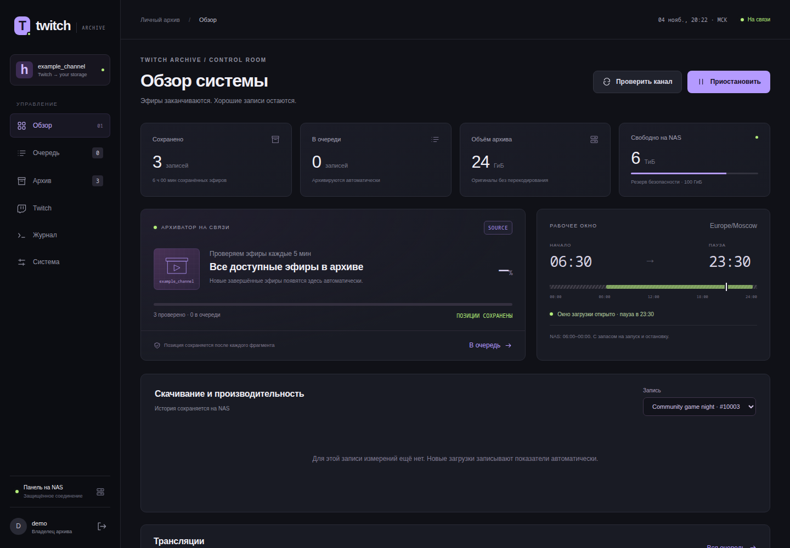

# Twitch Archive

A self-hosted Twitch VOD archiver with durable resume checkpoints, replay-chat exports and a private monitoring dashboard.

[](https://github.com/ari3lYT/twitch-archive/actions/workflows/ci.yml)
[](LICENSE)

[Quick start](#quick-start) · [Architecture](docs/architecture.md) · [Development](docs/development.md) · [Русский](docs/README.ru.md)


## See it



## Features

- Discover available VODs, queue downloads and resume from durable segment checkpoints.
- Verify completed recordings and keep metadata, thumbnails and checksums alongside the media.
- Export available replay chat as JSON, TXT and offline HTML; derive activity timelines from messages.
- Track transfer speed, retries, active time, pauses, resumptions and ETA through the daily schedule.
- Control the worker through a local Unix socket; the HTTP dashboard does not execute shell text.

## Quick start

Linux, Python 3.11+, FFmpeg and `yt-dlp` are required. The media worker also has a Dockerfile.

```bash
python3 -m venv .venv
. .venv/bin/activate
pip install -r requirements.txt
mkdir -p runtime/state runtime/archive
export CHANNEL=your_channel
export STATE_ROOT="$PWD/runtime/state"
export ARCHIVE_ROOT="$PWD/runtime/archive"
python archiver/archive.py
```

The default download window is **06:30–23:30 Europe/Moscow**, leaving a margin around a NAS
that sleeps approximately 00:00–06:00. The program never wakes the NAS. Set `DOWNLOAD_START`,
`DOWNLOAD_END` and `ARCHIVE_TIMEZONE` for a different installation; overnight windows are rejected.

For the dashboard, follow [deployment](docs/deployment.md): initialize a password, run the Unix-socket
controller and put the HTTP server behind TLS. [Configuration](docs/configuration.md) lists every path.

## Development

```bash
python -m unittest discover -s archiver -v
python -m unittest discover -s dashboard -v
```

Tests use temporary storage and synthetic HTTP data. They do not download a channel's archive.
Historical viewer counts, subscriptions, raids and moderation events cannot be reconstructed from
replay chat alone. Unavailable replay messages are reported as unavailable.

[Release verification and limits](docs/verification.md) · [Changelog](CHANGELOG.md)
