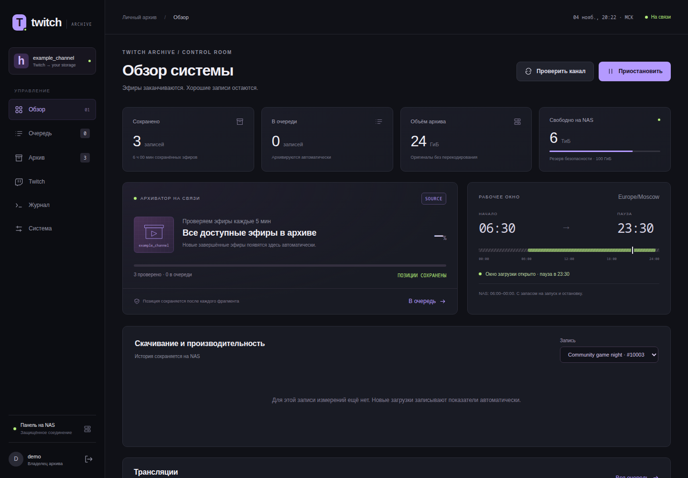

[English](README.md) · **Русский**


# Twitch Archive

Архиватор Twitch VOD для собственного сервера: надёжное возобновление загрузок, экспорт чата записи и закрытая панель мониторинга.

[](https://github.com/ari3lYT/twitch-archive/actions/workflows/ci.yml)
[](LICENSE)

[Быстрый старт](#быстрый-старт) · [Архитектура](docs/architecture.ru.md) · [Разработка](docs/development.ru.md)

## Скриншот



## Возможности

- Поиск доступных VOD, очередь загрузок и возобновление с сохранённых контрольных точек сегментов.
- Проверка готовых записей; метаданные, миниатюры и контрольные суммы рядом с видео.
- Экспорт доступного чата записи в JSON, TXT и автономный HTML; шкала активности на основе сообщений.
- Учёт скорости, повторных попыток, активного времени, пауз и возобновлений; расчёт ETA с учётом ежедневного расписания.
- Управление через локальный Unix-сокет; HTTP-панель не выполняет текстовые команды оболочки.

## Быстрый старт

Нужны Linux, Python 3.11+, FFmpeg и `yt-dlp`. Для загрузчика также есть Dockerfile.

```bash
python3 -m venv .venv
. .venv/bin/activate
pip install -r requirements.txt
mkdir -p runtime/state runtime/archive
export CHANNEL=your_channel
export STATE_ROOT="$PWD/runtime/state"
export ARCHIVE_ROOT="$PWD/runtime/archive"
python archiver/archive.py
```

По умолчанию загрузки разрешены **06:30–23:30 Europe/Moscow**: остаётся запас до и после сна NAS примерно с 00:00 до 06:00. Программа не будит NAS. Для другой установки задайте `DOWNLOAD_START`, `DOWNLOAD_END` и `ARCHIVE_TIMEZONE`; интервалы через полночь не допускаются.

Для панели следуйте [инструкции развёртывания](docs/deployment.ru.md): создайте пароль, запустите контроллер Unix-сокета и разместите HTTP-сервер за TLS-прокси. Все пути перечислены в [настройках](docs/configuration.ru.md).

## Разработка

```bash
python -m unittest discover -s archiver -v
python -m unittest discover -s dashboard -v
```

Тесты используют временное хранилище и искусственные HTTP-данные; они не скачивают архив реального канала. По одному чату записи нельзя восстановить историю числа зрителей, подписок, рейдов и действий модерации. Если сообщения записи недоступны, это явно указывается.

[Проверки релиза и их границы](docs/verification.ru.md) · [История изменений](CHANGELOG.ru.md)
