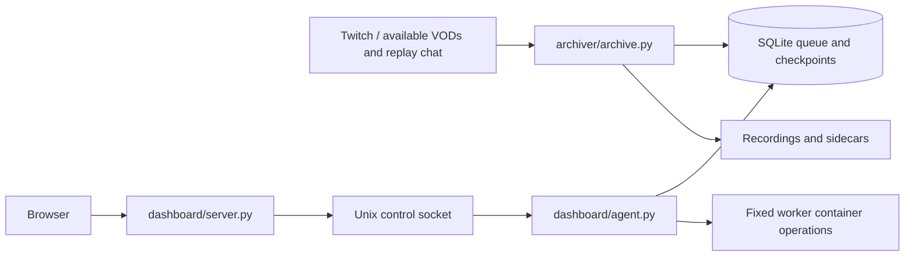

# Architecture

The worker limits buffered prefetch bytes, writes segment checkpoints durably, and distinguishes
pausing from completion. Transfer telemetry has its own database and never participates in committing
the video. `chat_archive.py` persists replay cursors, removes duplicates and writes offline exports.
`archive_insights.py` derives only facts supported by available replay messages.

The dashboard reads media through validated VOD IDs and filenames. Passwords use PBKDF2; sessions
use authenticated cookies and mutations require CSRF/origin checks. A narrow Unix-socket controller
performs an allowlisted set of Docker and queue operations. Do not expose the control socket over TCP.
`archive_schedule.py` is mirrored between the two service directories for standalone packaging;
the test runner checks that both copies stay identical.
