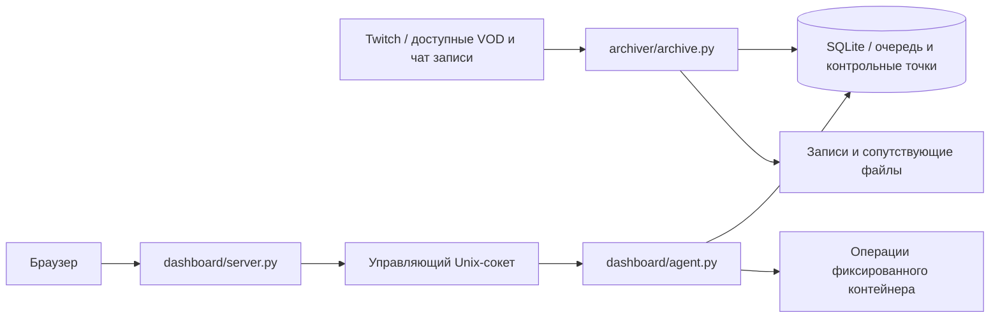

[English](architecture.md) · **Русский**

# Архитектура

Загрузчик ограничивает объём предварительно получаемых данных, надёжно записывает контрольные точки сегментов и различает паузу и завершение. Телеметрия передачи хранится в отдельной базе и не участвует в фиксации видео. `chat_archive.py` сохраняет позиции чтения чата записи, удаляет дубликаты и создаёт автономные экспорты. `archive_insights.py` выводит только факты, подтверждаемые доступными сообщениями записи.

Панель читает медиа только по проверенным ID VOD и именам файлов. Пароли защищены PBKDF2, сессии — аутентифицированными cookie, изменения — проверками CSRF/origin. Контроллер Unix-сокета выполняет ограниченный список операций Docker и очереди. Не открывайте управляющий сокет через TCP. `archive_schedule.py` продублирован в двух каталогах сервисов для независимой упаковки; тестовый запуск проверяет идентичность копий.
